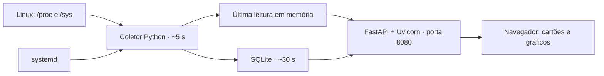

# Extract-Raspberry · API e monitor de desempenho

Painel web em português para acompanhar a temperatura e o uso de recursos de uma Raspberry Pi, com histórico local e gráficos no navegador. Não exige sensores externos ou serviços na nuvem. Usa FastAPI, Uvicorn e psutil em um ambiente virtual Python.

A evolução com dashboard foi desenvolvida com uma Raspberry Pi 4 de 4 GB, acessada por SSH, executando Debian GNU/Linux 13 (trixie), arquitetura `aarch64`. A primeira versão do painel foi confirmada em funcionamento nessa placa pelo usuário. O código de histórico passou por verificações locais; isso não representa uma certificação para outras placas ou distribuições.

O projeto original oferecia `GET /status` com uma leitura a cada requisição. Esta versão mantém essa API e acrescenta dashboard, coleta contínua e histórico, preservando a licença MIT original.

## Funcionalidades

- API original `GET /status`, com os mesmos campos JSON e leitura sob demanda.
- APIs `GET /api` e `GET /api/history` para a interface e outras integrações.
- Documentação interativa em `/docs` e esquema OpenAPI em `/openapi.json`.
- Leitura de temperatura do processador, CPU, RAM, disco da partição `/` e tempo ligada.
- Gráficos de temperatura, CPU e RAM para 1 hora, 24 horas, 7 dias e 30 dias.
- Coleta independente do navegador e da sessão SSH.
- Persistência em SQLite e inicialização automática com systemd.
- Interface responsiva com gráficos em Canvas, sem CDN ou dependências externas.
- Histórico com retenção de aproximadamente 30 dias.

O disco e o tempo ligada aparecem nos cartões atuais; não são gravados no histórico nesta versão.

## Como funciona



| Operação | Frequência aproximada |
| --- | --- |
| Coletar métricas e atualizar cartões abertos | 5 segundos |
| Gravar histórico e atualizar gráficos abertos | 30 segundos |
| Remover registros com mais de 30 dias | Na primeira gravação e a cada 24 horas |

Os intervalos incluem o tempo de processamento e não são uma programação de tempo real. Após reiniciar, o serviço volta a coletar e usa o mesmo banco. Não há leituras enquanto a placa está desligada. A página deixa de ligar pontos separados por lacunas grandes; interrupções curtas podem ficar ocultas pela agregação.

## Requisitos

- Raspberry Pi com Linux, Python 3.10 ou mais recente e módulo padrão `sqlite3`.
- systemd e permissão para executar comandos administrativos com `sudo`.
- Acesso por SSH ou terminal local e conectividade de rede com o navegador.
- Espaço de armazenamento para o programa e o banco de dados.
- Git, se a instalação for feita por clone do repositório.
- Pacote `python3-venv` e acesso à internet durante a instalação das dependências.

O monitor coleta informações do Linux. O backend não funciona como monitor do Windows. A temperatura depende da existência de `/sys/class/thermal/thermal_zone0/temp`; na ausência desse arquivo, aparece como indisponível. Em outras placas, confirme se essa zona térmica corresponde ao processador.

## Instalar do zero na Raspberry

Execute os comandos abaixo **no SSH da Raspberry**, como seu usuário normal. Use o repositório abaixo após integrar a atualização à branch principal. Para uma branch em revisão, faça checkout dela antes de instalar.

```bash
sudo apt update
sudo apt install -y python3 python3-venv git
mkdir -p ~/src
git clone https://github.com/IsaacMartins12/Extract-Raspberry.git ~/src/monitor-rasp
cd ~/src/monitor-rasp
sh instalar.sh
```

Não execute o instalador inteiro com `sudo`: ele usa sua pasta pessoal e solicita os privilégios necessários internamente.

Se houver um processo manual ocupando a porta 8080, encerre-o com `Ctrl+C` antes de instalar.

O instalador:

1. Verifica Python, SQLite, sintaxe dos programas e presença da interface.
2. Prepara `~/painel-rasp/.venv` e instala `requirements.txt` antes de parar o serviço.
3. Cria `~/painel-rasp` e faz backup dos arquivos anteriores, se existirem.
4. Para o serviço existente e copia o backend, a interface e a lista de dependências.
5. Configura `/etc/systemd/system/painel-rasp.service` para executar com seu usuário.
6. Habilita o início no boot, inicia o serviço e mostra o status.

Ele preserva o banco existente. A pasta pessoal não deve conter espaços, limitação do instalador atual. As cópias de código do instalador não equivalem a um backup do histórico.

Confira o serviço e descubra o endereço da placa:

```bash
systemctl status painel-rasp --no-pager
hostname -I
```

Abra `http://IP_DA_RASPBERRY:8080` no computador ou celular da mesma rede. Aguarde aproximadamente um minuto para ter os primeiros pontos. O histórico começa com a instalação; não é possível recuperar métricas anteriores à coleta.

## Atualizar uma instalação existente

Se já estiver usando o serviço e tiver clonado o projeto em `~/src/monitor-rasp`:

```bash
cd ~/src/monitor-rasp
git pull --ff-only
sh instalar.sh
```

Se o Git indicar alterações locais ou divergência, resolva isso antes de instalar. O comando não força a substituição de alterações no clone.

Depois, atualize a página com `Ctrl+F5`. Para instalar a partir do computador Windows, veja o [guia de transferência por SSH](docs/operacao.md#transferir-do-windows-para-a-raspberry).

## Executar manualmente

Para desenvolvimento, sem instalar o serviço:

```bash
cd ~/src/monitor-rasp
python3 -m venv .venv
.venv/bin/python -m pip install -r requirements.txt
.venv/bin/python server.py
```

A execução manual de `server.py` usa a porta **8000**, como no projeto antigo. Para usar 8080, execute `.venv/bin/python server.py --port 8080`. O comando `.venv/bin/python painel.py` também inicia a aplicação na porta 8080 para facilitar a migração.

Encerre com `Ctrl+C`. O processo manual grava o banco na pasta do script e depende do terminal aberto. Se for executar manualmente na porta 8080 e o serviço já estiver ativo, pare-o antes com `sudo systemctl stop painel-rasp` e inicie novamente após o teste. O banco do clone e o banco instalado em `~/painel-rasp` são arquivos distintos.

## Arquivos do projeto

```text
Extract-Raspberry/
├── server.py          # FastAPI: API original, dashboard e histórico
├── painel.py          # Coletor e persistência SQLite
├── requirements.txt   # Dependências da aplicação
├── requirements-dev.txt # Dependências para os testes
├── LICENSE            # MIT original do projeto
├── index.html         # Interface e gráficos em Canvas
├── instalar.sh        # Instalação e atualização do serviço
├── README.md
├── .gitignore         # Exclui bancos, backups e configurações locais
├── .gitattributes     # Preserva LF nos scripts para Linux
├── docs/
│   ├── arquitetura.md # Métricas, agregação, API e limitações
│   ├── operacao.md    # Serviço, backup, recuperação e problemas comuns
│   └── github.md      # Como publicar e manter o repositório
└── tests/
    └── test_painel.py # Verificações de API, contrato e persistência
```

Após a instalação, `~/painel-rasp` também terá `historico.sqlite3`, possíveis arquivos auxiliares `-wal` e `-shm` e pastas `backup-*`. Esses dados locais ficam fora do Git.

## Comandos úteis

```bash
# Status e logs
systemctl status painel-rasp --no-pager
journalctl -u painel-rasp -n 50 --no-pager

# Reiniciar, parar e iniciar
sudo systemctl restart painel-rasp
sudo systemctl stop painel-rasp
sudo systemctl start painel-rasp

# Consultar a API na própria Raspberry
curl http://127.0.0.1:8080/api
curl 'http://127.0.0.1:8080/api/history?period=1h'
```

Se `curl` não estiver instalado: `sudo apt install -y curl`.

## Verificar o código

Na raiz do projeto:

```bash
.venv/bin/python -m pip install -r requirements-dev.txt
.venv/bin/python -m unittest discover -s tests -v
.venv/bin/python -m py_compile painel.py server.py
sh -n instalar.sh
```

Os testes usam banco temporário e cliente HTTP de teste para verificar retenção, agregação, persistência, respostas HTTP e o contrato original de `/status`. Não exercitam o hardware real nem substituem a conferência dos gráficos no navegador. A operação do systemd precisa ser validada na Raspberry.

## Acesso e limitações

O servidor escuta em `0.0.0.0:8080`, sem autenticação e sem HTTPS. É um protótipo para uma rede de confiança; não encaminhe essa porta no roteador para a internet. O servidor é Uvicorn com FastAPI. Use um único processo/worker para não duplicar os coletores. Uma implantação exposta exige configuração adicional de autenticação, TLS e controle de acesso.

Esta versão não tem alertas, detecção de throttling, análise por processo ou histórico de disco. Médias dos períodos maiores suavizam picos, e gravar uma amostra a cada 30 segundos pode perder variações breves. O último trecho ainda não gravado não sobrevive ao encerramento do processo.

## Consumir a API

Com o serviço instalado:

```bash
# Leitura nova sob demanda, compatível com a API antiga (~1 segundo para CPU)
curl http://127.0.0.1:8080/status

# Última leitura já disponível no coletor
curl http://127.0.0.1:8080/api

# Histórico agregado
curl "http://127.0.0.1:8080/api/history?period=24h"
```

Na execução manual padrão, troque `8080` por `8000`. Os campos antigos permanecem em `/status`; `/api` tem um formato próprio para o dashboard.

## Documentação detalhada

- [Arquitetura, métricas e API](docs/arquitetura.md).
- [Operação, backup e resolução de problemas](docs/operacao.md).
- [Publicação no GitHub](docs/github.md).

O procedimento segue as referências oficiais de [Linux `/proc`](https://www.kernel.org/doc/html/latest/filesystems/proc.html), [SQLite WAL](https://www.sqlite.org/wal.html), [systemd](https://www.freedesktop.org/software/systemd/man/258/systemd.service.html) e [publicação de código no GitHub](https://docs.github.com/en/migrations/importing-source-code/using-the-command-line-to-import-source-code/adding-locally-hosted-code-to-github).

## Licença

[MIT](LICENSE), preservando o copyright original de Isaac Martins (2025).
